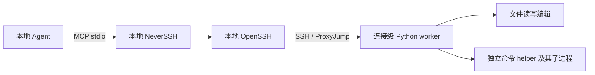

# NeverSSH

让本地 Agent 通过 MCP 连接远程项目，读取项目规则和 skill，完成读代码、修改、测试和 diff 检查。Agent、模型连接和 MCP 服务运行在本地；远端使用现有 `sshd` 和 Python 标准库，无需部署模型或 Agent 服务。



Agent 可以调用 `ssh_discover({})` 一次获取全部候选入口，也可以直接提交目标地址。`ssh_connect` 在远端 worker 就绪后返回短 `connection_id`；开发项目时用 `ssh_workspace_open` 打开目录，取得 `workspace_id` 和项目上下文。命令和文件操作选择其中一个 ID，任务工具使用 `ssh_bash` 在需要跟进时返回的 `task_id`。默认沿用本机 SSH 能力；用户可以屏蔽目标或只开放指定目标。

连接和命令工具的参数、返回值和调用示例见 [工具接口](docs/interfaces.md)；构建缓存、版本和兼容策略见 [版本与兼容](docs/compatibility.md)，变更记录见 [CHANGELOG](CHANGELOG.md)。

## 运行条件

- 本地 macOS 或 Linux、Bun 1.3+、OpenSSH 客户端（包含 `ssh` 和 `sftp`）。
- 远端 Linux、Python 3.8+、Bash 和可写的 HOME。远端不要求 uv、Bun 或第三方 Python 包。
- 上传和下载需要远端启用 SFTP 子系统；SFTP 不可用时工具直接报错，不回退。
- 本机已有可用的非交互 SSH 认证和经过核实的主机密钥记录。工具使用 `BatchMode=yes`、`StrictHostKeyChecking=yes`。
- 远端 `rg` 可选；需要内容搜索时通过 `ssh_bash` 使用。
- 远端 Git 可选；工作区用它检查分支和已有改动。Git 不可用时仍可读取项目规则、skill 和文件。

首次连接会把内容寻址的 worker 源码安装到远端 `~/.neverssh/builds/<buildId>/`，后续连接复用；不安装依赖、不监听端口、没有独立后台服务。活动 worker 对构建持有共享锁，默认保留当前构建和最近 2 个未锁定构建；超过 30 天的未锁定构建也会清理。worker 随连接退出；文件读写编辑由常驻 worker 直接执行，Bash 使用独立 helper 进程。A/B、回滚和版本校验见[版本与兼容](docs/compatibility.md)。

## 开始使用

```sh
bun install --frozen-lockfile
bun run src/index.ts
```

默认配置文件 `./neverssh.config.json` 可以省略。可使用示例配置添加本地设置：

```sh
cp neverssh.config.example.json neverssh.config.json
```

```json
{
  "version": 1,
  "access": {
    "deny": [{"host":"production.example.com"}]
  },
  "localTransferRoots": [],
  "compression": true,
  "maxFileBytes": 4194304,
  "maxTaskOutputBytes": 67108864,
  "maxArchiveBytes": 1073741824
}
```

也可以通过 `access.allow` 只开放指定目标：

```json
{
  "access": {
    "allow": [{"host":"dev-*","user":"developer"}],
    "deny": []
  }
}
```

`allow` 省略表示默认开放，空数组表示全部关闭；`deny` 优先。每条规则必须填写 `host`，可选 `user` 和 `port`；同一条规则的字段需同时满足。

`host` 匹配请求入口和 OpenSSH 求值后的主机名，不区分大小写；`user` 匹配实际账号，区分大小写。两者支持 `*`、`?` 通配符。规则按名字匹配，不会把 DNS 名、IP 和其他别名自动认作同一台服务器；屏蔽实际端点时应填写对应主机名或地址。规则控制最终操作目标，跳板继续由 SSH 配置管理。

端口、身份文件、证书和跳板等继续使用 SSH 配置。可用顶层 `sshConfig` 指定自定义配置文件。`--config` 和 `NEVERSSH_CONFIG` 显式指定的配置文件必须存在。旧版 `targets` 配置已移除；远端项目目录通过工作区指定，也可在连接模式下按次传入 `cwd`。

CLI 可以只列出候选，或者诊断指定目标；诊断会报告远端 Python 版本、平台、Bash 路径和 HOME 文件系统类型。归档锁假设本地 Linux 文件系统，NFS/SMB 上的锁和配额需要额外验证：

```sh
bun run src/index.ts doctor
bun run src/index.ts doctor my-dev-server
```

不指定目标时不连接服务器。指定目标时建立临时连接、报告远端环境，并在退出前清理。

## 添加到 MCP 客户端

### 从 GitHub Release 启动

安装一个很小的 launcher：启动时直接执行已缓存的 Release，并在后台解析 GitHub 最新 Release、按标签缓存 `neverssh.js`，新版本在下次启动生效：

```sh
mkdir -p ~/.local/bin
curl -fsSL https://github.com/Jacko-John/NeverSSH/releases/latest/download/neverssh -o ~/.local/bin/neverssh
chmod +x ~/.local/bin/neverssh
```

在 Claude Code 的 `.mcp.json` 中填写 launcher 的绝对路径。这个示例将工具调用超时设为 660 秒（660000 毫秒），为最长的前台等待预留启动和响应时间。

```json
{
  "mcpServers": {
    "neverssh": {
      "command": "/Users/you/.local/bin/neverssh",
      "timeout": 660000
    }
  }
}
```

其他 MCP 客户端请在各自的设置中将工具调用超时和空闲超时设为至少 660 秒。需要给 launcher 指定 NeverSSH 配置文件时，可以传入 `--config`。

```json
{
  "mcpServers": {
    "neverssh": {
      "command": "/Users/you/.local/bin/neverssh",
      "args": ["--config", "/absolute/path/neverssh.config.json"]
    }
  }
}
```

launcher 需要本机有 `curl`、`bun` 1.3+ 和 OpenSSH 客户端。有缓存时启动不等待网络，解析或下载失败只影响后台刷新，留待下次启动重试；只有缓存为空的首次启动需要网络。GUI 客户端需要可用的 `ssh` 搜索路径和 SSH Agent 环境。

### 从源码开发

```json
{
  "mcpServers": {
    "neverssh": {
      "command": "/absolute/path/to/bun",
      "args": ["run", "/absolute/path/to/NeverSSH/src/index.ts"]
    }
  }
}
```

需要自定义配置时，在 `args` 中增加 `--config` 和配置文件绝对路径。

工作区通过普通 MCP 工具提供上下文；MCP 无法重定向客户端自带的本地 shell、编辑器或搜索工具，也不能保证客户端自动加载规则。仓库内的 [Agent skill](skills/neverssh/SKILL.md) 覆盖安装、工作区上下文和远端开发流程。以 Claude Code 为例，复制到用户级 skill 目录即可使用：

```sh
mkdir -p ~/.claude/skills
cp -R skills/neverssh ~/.claude/skills/
```

安装后，支持该格式的客户端可以按 skill 说明选择远端工具；加载和触发方式由客户端决定。安装与排错细节见 `skills/neverssh/references/installation.md`。

## 开发远程项目

连接后，用 `ssh_workspace_open` 打开项目目录：

```json
{"connection_id":"7a2c9d4f","path":"/srv/app"}
```

返回工作区 ID（例如 `ws_b8e3a160`）、远端项目根目录、Git 状态、项目入口文件，以及根目录的 `AGENTS.md` 正文和可用 skill 目录。Git 状态最多列出前 50 项，并标出省略的项数。需要完整清单时，在工作区用 `ssh_bash` 运行 `git status --short -- .`。相对文件路径和 `cwd` 基于项目根目录，命令默认在根目录执行。

项目文件默认直接在远端处理：用 `ssh_read_file` 读取，`ssh_write_file` 创建或整体写入，`ssh_edit_file` 做局部修改。批量变更和代码生成通过远端 `ssh_bash` 完成，再在远端测试和检查 diff。不要把“本地临时文件加上传”或“下载、本地编辑、再上传”当成默认开发流程。

普通工作区操作从根目录向目标收集适用的 `AGENTS.md`，保留来源、适用目录和完整正文。例如，首次向带有独立规则的子目录写文件时，`ssh_write_file` 会先返回 `WORKSPACE_RULES_CHANGED` 和规则，文件保持原样。阅读后可直接重试。编辑和上传采用同样的流程，已交付的规则发生变更或删除时也会暂停。读取、下载和 Bash 会随结果返回适用的规则变化。文件路径限制、读取后编辑和版本冲突检查仍然生效。

客户端先收到操作结果，再收到有变化的工作区规则。读取单张图片会返回一个图片块，笔记本可以返回多个文本块和图片块，规则增量始终附在最后。Bash 即使以非零状态退出，也可能附上规则提示，命令已经运行，不要因此重新执行。执行文件或传输操作时发生的错误不交付规则。

普通操作不重复返回未变化的规则、Skill 目录和 Git 状态。需要恢复根目录上下文、刷新 Git 状态或重新发现 skill 时，再次调用 `ssh_workspace_open`。相同连接、根目录和 skill 配置可以复用工作区 ID，但会重置已返回规则的记录并重建 skill 目录。打开时只返回根目录规则，子目录规则会随后随目标操作自动返回。Bash 的规则发现只覆盖 `cwd`；涉及其他目录时，可以在对应 `cwd` 操作或主动读取该目录的 `AGENTS.md`。连接模式不加载项目上下文。

默认只从工作区根目录下的 `.agents/skills` 和 `.claude/skills` 发现 skill，不支持随操作路径发现子目录 skill。进入子目录不会新增该子目录的 skill；`AGENTS.md` 仍按目标路径收集。`skill_directories` 可替换默认搜索目录：相对目录从工作区根解析一次，绝对路径和 `~/` 可指定远端共享或个人目录。

skill 目录列出可调用名称和描述；使用时通过 `ssh_skill_read({workspace_id,skill_name:"testing"})` 读取完整 `SKILL.md`，再按需读取引用资源。名称唯一时直接使用 `testing`；名称冲突时用短目录前缀区分，例如 `project@check`、`shared@check`，仍有冲突时加短后缀。当前打开期间名称保持原来源；再次打开后以新目录中的名称为准。原样使用目录返回的名称；服务器精确匹配已登记名称，不把名称解析为文件路径。工具不会自动安装依赖或执行脚本；skill 的脚本在远端运行，本地个人 skill 继续由客户端管理。

项目操作使用现有工具，且每次必须只填 `workspace_id` 或 `connection_id` 中的一个：

```json
{"workspace_id":"ws_b8e3a160","file_path":"src/main.ts"}
```

读代码、修改后，在远端运行项目要求的测试和检查，再查看相关 `git diff`、`git diff --check` 和 `git status --short`。初始 Git 状态只是快照，不能将所有脏文件自动归属到当前任务；保留用户已有改动，提交和推送遵循用户授权。

工作区管理远端路径和项目上下文，没有把项目挂载到本地 IDE，也不是命令沙箱。文件路径和规则收集范围限制在项目根目录内，Bash 仍具有 SSH 账号的权限。当前规则支持 `AGENTS.md`，不模拟各客户端的专用规则、hooks 或原生编辑器集成。

对话压缩后再次打开工作区，恢复根目录上下文并重读仍需使用的 skill；后续目标操作会重新返回适用的子目录规则。服务器无法判断模型是否还记得内容。断线后重新连接并打开工作区，先检查远端实际状态，不自动重放命令或修改。

## 工具使用

工具返回可读文本。`ssh_read_file` 还可以用原生 MCP `image` 内容块展示图片和笔记本中保存的图形输出。所有工具都不提供 `structuredContent` 或 `outputSchema`。请求仍是严格校验的 MCP 参数对象；远端命令打印的内容保持原样。

连接：

```json
{"host":"my-dev-server"}
```

`ssh_connect` 返回：

```text
Connection: 7a2c9d4f
```

调用 `ssh_sessions({})` 一次列出当前可用的全部连接。

后续读取、编辑和运行命令使用这个 ID；任务查询与停止只使用 `task_id`：

```json
{"connection_id":"7a2c9d4f","file_path":"/srv/app/src/main.ts"}
```

```json
{"connection_id":"7a2c9d4f","cwd":"/srv/app","command":"make test","wait_seconds":120}
```

| 能力 | 工具 |
| --- | --- |
| 发现与连接 | `ssh_discover`、`ssh_connect`、`ssh_sessions`、`ssh_close` |
| 项目上下文 | `ssh_workspace_open`、`ssh_skill_read` |
| 命令和任务 | `ssh_bash`、`ssh_task_output`、`ssh_task_stop`、`ssh_task_list` |
| 文件 | `ssh_read_file`、`ssh_write_file`、`ssh_edit_file` |
| 二进制传输 | `ssh_upload`、`ssh_download` |

文件工具对齐 Claude Code 的 Read / Write / Edit：`file_path` 是远端文件路径，文本读取使用 `offset` / `limit`，编辑使用 `old_string` / `new_string` / `replace_all`。目录列表、文件查找和内容搜索通过 `ssh_bash` 执行 `ls`、`find`、`rg`。

编辑已有文件前，用 `ssh_read_file` 读完同一版本的全部内容，或在 `ssh_bash` 中用 `cat src/main.ts` 等命令查看单个文件。再次读取时，如果内容已在外部改变，工具会提示。精确编辑默认要求原文唯一，`replace_all=true` 可替换所有匹配。成功后会显示第一处替换附近的行号和正文。

超过 256 KiB 的文本需要指定 `offset` 和较小的 `limit` 分页读取。读取 Jupyter `.ipynb` 会按顺序展示单元格和保存的输出。直接读取 PDF 会返回格式不支持的错误。远端已安装 `pdftotext` 时，可通过 `ssh_bash` 运行 `pdftotext report.pdf -` 提取正文。

查看远端图片也直接调用 `ssh_read_file`，无需先下载到本地。工具按文件内容识别 PNG、JPEG、GIF 和 WebP，并完整返回图片，不写成本地文件，不依赖 SFTP；客户端需要支持 MCP 图片显示。`offset` / `limit` 只用于文本，图片不分页，仍受 `maxFileBytes` 限制（默认 4 MiB，最高 8 MiB）。SVG 按文本读取。遇到 XLSX、Parquet 或 ZIP 等二进制文件，使用对应格式的 skill 或在 `ssh_bash` 中调用专用工具。

图片及附带规则的 MCP 结果序列化后另有 9 MiB 上限，不能按原始图片大小理解。超过该上限会返回文本错误，需缩小图片后重试；不会截断图片或自动下载到本地。

`ssh_bash` 的短命令成功完成时，操作结果只有程序输出；后台运行、等待到期、输出截断或失败时再给出 `task_...` 任务 ID、状态、远端日志路径和字节数。工作区规则有变化时，在独立的第二个文本块中附上提示。后台任务只需 `task_id` 调用 `ssh_task_output` 查询或等待，使用 `ssh_task_stop` 停止，不再需要 `connection_id`。`ssh_task_list` 列出尚未被 `ssh_task_output` 读取输出的任务；读取后移除，新输出会让它重新出现。

`ssh_bash` 默认等待 120 秒，最长 600 秒。`ssh_task_output` 默认等待 30 秒，最长 300 秒。两者都支持小数。等待到期后原进程继续运行，设置 `run_in_background=true` 可在启动后立即返回。单独运行 `rg`、`grep` 等命令时，退出码 1 也能作为正常结果返回，例如一次没有匹配项的搜索。

每次命令使用独立的 Bash，stdin 默认为 EOF，没有 PTY。连接模式的 `cwd` 默认是远端 HOME，工作区模式默认是项目根目录；`cd` 和变量不会延续到下一条命令。环境变量可直接写进命令，例如 `CI=1 make test`。

日志包含原始命令及其输出，位于远端 `~/.neverssh/sessions/<connection_id>/<task_id>.log`，从任务结束起保留 14 天。关闭连接或退出 MCP 会停止任务并保留日志。预览未显示完整输出时，工具才给出读取提醒。大日志用 `ssh_bash` 执行 `tail`、限定范围的 `sed` 或针对性 `rg`，避免整份加载进上下文。清理器跳过活动任务；离线期间过期的日志在下次连接时补清理。

## 传输与资源

`ssh_upload` 用于把用户已有的本地文件传到远端，或完成明确的传输需求；`ssh_download` 用于把需要的文件取回本地。具体任务确实依赖本地专用工具时，可以传输相关文件；日常项目开发仍按前述远端流程进行。

`ssh_upload` / `ssh_download` 每次通过 `localPath` 指定本地文件，无需预先配置传输目录。`localPath` 必须是运行 MCP 服务的本机上的绝对路径；`remotePath` 和 `cwd` 是远端路径，工作区根目录不会用来解析本地路径。

省略 `localTransferRoots` 或设置为 `[]` 时，不限制本地目录。需要限定范围时，配置非空目录列表；每项必须是已存在的目录，配置中的相对路径基于配置文件目录解析。本地真实路径必须位于其中一个目录内，不能通过符号链接逃离范围。下载会自动创建缺失的本地父目录；配置目录限制时，创建前也会检查范围。

传输仍检查普通文件、大小、覆盖权限和取消状态，下载先暂存再原子提交。两种工具使用 SFTP，复用已认证的 ControlMaster；`compression: true`（默认）同时压缩 worker 和 SFTP 的 SSH 流量。

- 每条连接最多 4 个活动命令、8 个并行请求和 64 个排队请求；SSH 只为 worker 保留一个 session channel。
- 连接注册表最多保留 64 项；容量紧张时移除已关闭记录。ID 在当前实例中不重复分配。
- 本地内联预览最多保留最近 64 KiB 或 4096 个片段；任务表最多 256 项。新任务启动时移除结束已满 14 天的本地记录，容量紧张时可提前移除已结束记录；远端日志保留期不受影响。
- 默认每任务日志最多 64 MiB，远端同一用户归档总量最多 1 GiB，分别使用 `maxTaskOutputBytes` 和 `maxArchiveBytes` 调整。达到预算时停止任务或拒绝启动，明确报告日志不完整，不提前删除未过期日志。计数只包括日志内容，不是整个文件系统的磁盘配额。
- 文件和传输默认上限 4 MiB，可配置到 8 MiB。精确编辑要求 UTF-8。读取其他文本编码时，无法解码的字节显示为 �。完整读取后可用 `ssh_write_file` 提供干净的 UTF-8 全文进行转换。
- 同一 worker 对同一文件的文本写入、编辑和上传提交会串行校验版本。禁止覆盖的上传以原子的创建操作提交；文本写入和编辑保留 Unix mode 和所有者，SFTP 上传不保证保留它们。两者都不保证 ACL、扩展属性和硬链接关系；哈希校验不构成跨进程事务锁。

## 生命周期与信任范围

连接默认不设空闲过期时间。任务结束或长时间没有工具调用时，连接和 worker 继续保留，后续任务可复用同一个 `connection_id`。建连超时只限制连接准备；命令等待到期不影响连接和任务寿命。

`ssh_close` 强制关闭指定连接，同时取消活动任务和操作。连接失效时结束会话，MCP 退出时统一清理活动任务和连接。`remote_cleanup` 区分已确认收尾与远端状态未知。

停止任务和正常断开会清理管理的命令进程组；刻意脱离会话的守护进程可能不在管理范围内。失效连接会从 `ssh_sessions` 的结果中移除。工具不会自动重连或重放命令与写入，重新连接后需先检查远端实际状态。

工具具有 SSH 账号的远端权限，`cwd` 不是沙箱。SSH 配置是本地可信配置，包括 `ProxyCommand`、`Match exec` 等可能运行本地程序的配置项。工具不接受模型提供的 SSH 选项、密码或私钥，关闭 SSH Agent/X11 转发、配置中的端口转发及 LocalCommand，不修改主机信任记录。

NeverSSH 不调用模型 API。远端命令自身的网络请求仍来自远端。stdout 只承载 MCP 协议；远端输出和文件内容应当作为任务数据处理。

## 开发验证

源码按职责组织：`src/mcp/` 管理工具接口和通用结果文本，`src/ssh/` 管理连接与 worker 请求协议，`src/tasks/` 管理 Bash 任务和预览，`src/files/` 管理文件修订与传输，`src/workspaces/` 管理工作区与项目上下文。`src/remote/` 保存 Python 远端运行时及本地 bundle 定义；`src/runtime.ts` 统一持有状态，`src/index.ts` 负责 CLI 和 stdio 生命周期。开发规范和正反示例见[项目开发 skill](.agents/skills/neverssh-development/SKILL.md)。

```sh
bun run check
bun run docs:check
bun test
bun run build
```

全部 15 个工具的输入 schema 集中在 `src/mcp/contracts.ts`，按当前 `maxFileBytes` 构建。修改 schema 后运行 `bun run docs:sync` 更新字段表，并同步行为说明和示例。字段表使用默认配置；测试会检查全部工具的覆盖、字段表同步及示例是否通过实际 schema 校验。

JavaScript/TypeScript 使用 Bun。本地 Python 检查和测试解释器由 uv 执行。集成测试创建临时 SSH 密钥和仅监听回环地址的 SSH 测试服务，使用系统 OpenSSH 和 MCP stdio 验证工具，不修改用户 SSH 配置。

集成测试覆盖 SSH 协议和本机 POSIX 进程行为；真实 Linux、不同 OpenSSH 版本和复杂跳板环境仍需发布前验收。

## 发布

推送 `v*` 标签会触发 GitHub Actions：

```sh
git tag -a v0.6.0 -m "NeverSSH 0.6.0"
git push origin v0.6.0
```

工作流运行检查、测试和构建，并上传 `neverssh.js`、`neverssh` launcher 和 `neverssh.config.example.json` 到对应 Release。launcher 在后台解析 `releases/latest`，新标签在用户下一次启动时生效，无需修改 MCP 配置。
