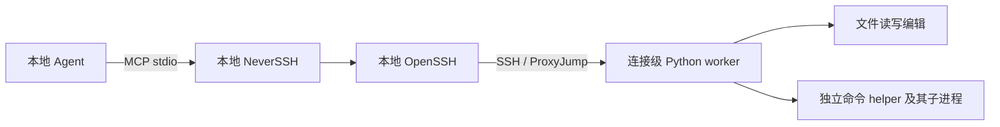

# NeverSSH

让本地 Agent 通过 MCP 发现和操作 SSH 远程环境。Agent、模型连接和 MCP 服务运行在本地；远端使用现有 `sshd` 和 Python 标准库，无需部署模型或 Agent 服务。



Agent 可以调用 `ssh_discover({})` 一次获取全部候选入口，也可以直接提交目标地址。`ssh_connect` 在远端 worker 就绪后返回短 `connection_id`，命令和文件操作通过该 ID 引用连接；任务工具使用 `ssh_bash` 在需要跟进时返回的 `task_id`。默认沿用本机 SSH 能力；用户可以屏蔽目标或只开放指定目标。

连接和命令工具的参数、返回值和调用示例见 [工具接口](docs/interfaces.md)；构建缓存、版本和兼容策略见 [版本与兼容](docs/compatibility.md)，变更记录见 [CHANGELOG](CHANGELOG.md)。

## 运行条件

- 本地 macOS 或 Linux、Bun 1.3+、OpenSSH 客户端（包含 `ssh` 和 `sftp`）。
- 远端 Linux、Python 3.8+、Bash 和可写的 HOME。远端不要求 uv、Bun 或第三方 Python 包。
- 上传和下载需要远端启用 SFTP 子系统；SFTP 不可用时工具直接报错，不回退。
- 本机已有可用的非交互 SSH 认证和经过核实的主机密钥记录。工具使用 `BatchMode=yes`、`StrictHostKeyChecking=yes`。
- 远端 `rg` 可选；需要内容搜索时通过 `ssh_bash` 使用。

首次连接会把内容寻址的 worker 源码安装到远端 `~/.neverssh/builds/<buildId>/`，后续连接复用；不安装依赖、不监听端口、没有独立后台服务。活动 worker 对构建持有共享锁，默认保留当前构建和最近 2 个未锁定构建；超过 30 天的未锁定构建也会清理。worker 随连接退出；文件读写编辑由常驻 worker 直接执行，Bash 使用独立 helper 进程。A/B、回滚和版本校验见[版本与兼容](docs/compatibility.md)。

## 开始使用

```sh
bun install --frozen-lockfile
bun run src/index.ts
```

默认配置文件 `./neverssh.config.json` 可以省略。可使用示例配置添加本地设置：

```sh
cp neverssh.config.example.json neverssh.config.json
```

```json
{
  "version": 1,
  "access": {
    "deny": [{"host":"production.example.com"}]
  },
  "localTransferRoots": [],
  "compression": true,
  "maxFileBytes": 4194304,
  "maxTaskOutputBytes": 67108864,
  "maxArchiveBytes": 1073741824
}
```

也可以通过 `access.allow` 只开放指定目标：

```json
{
  "access": {
    "allow": [{"host":"dev-*","user":"developer"}],
    "deny": []
  }
}
```

`allow` 省略表示默认开放，空数组表示全部关闭；`deny` 优先。每条规则必须填写 `host`，可选 `user` 和 `port`；同一条规则的字段需同时满足。

`host` 匹配请求入口和 OpenSSH 求值后的主机名，不区分大小写；`user` 匹配实际账号，区分大小写。两者支持 `*`、`?` 通配符。规则按名字匹配，不会把 DNS 名、IP 和其他别名自动认作同一台服务器；屏蔽实际端点时应填写对应主机名或地址。规则控制最终操作目标，跳板继续由 SSH 配置管理。

端口、身份文件、证书和跳板等继续使用 SSH 配置。可用顶层 `sshConfig` 指定自定义配置文件。`--config` 和 `NEVERSSH_CONFIG` 显式指定的配置文件必须存在。旧版 `targets` 配置已移除；远端项目目录改为操作时传入 `cwd`。

CLI 可以只列出候选，或者诊断指定目标；诊断会报告远端 Python 版本、平台、Bash 路径和 HOME 文件系统类型。归档锁假设本地 Linux 文件系统，NFS/SMB 上的锁和配额需要额外验证：

```sh
bun run src/index.ts doctor
bun run src/index.ts doctor my-dev-server
```

不指定目标时不连接服务器。指定目标时建立临时连接、报告远端环境，并在退出前清理。

## 添加到 MCP 客户端

### 从 GitHub Release 启动

安装一个很小的 launcher，之后每次启动都会解析 GitHub 最新 Release，按标签缓存 `neverssh.js` 并执行：

```sh
mkdir -p ~/.local/bin
curl -fsSL https://github.com/Jacko-John/NeverSSH/releases/latest/download/neverssh -o ~/.local/bin/neverssh
chmod +x ~/.local/bin/neverssh
```

MCP 配置只需要指向这个 launcher：

```json
{
  "mcpServers": {
    "neverssh": {
      "command": "/Users/you/.local/bin/neverssh"
    }
  }
}
```

需要自定义配置文件时：

```json
{
  "mcpServers": {
    "neverssh": {
      "command": "/Users/you/.local/bin/neverssh",
      "args": ["--config", "/absolute/path/neverssh.config.json"]
    }
  }
}
```

launcher 需要本机有 `curl`、`bun` 1.3+ 和 OpenSSH 客户端。Release 解析或新版本下载失败时会回退到最近一次成功缓存的版本；首次启动需要网络。GUI 客户端需要可用的 `ssh` 搜索路径和 SSH Agent 环境。

### 从源码开发

```json
{
  "mcpServers": {
    "neverssh": {
      "command": "/absolute/path/to/bun",
      "args": ["run", "/absolute/path/to/NeverSSH/src/index.ts"]
    }
  }
}
```

需要自定义配置时，在 `args` 中增加 `--config` 和配置文件绝对路径。

MCP 无法重定向客户端自带的本地 shell、编辑器或搜索工具。仓库内的 [Agent skill](skills/neverssh/SKILL.md) 覆盖安装、目标选择、命令与文件操作流程。以 Claude Code 为例，复制到用户级 skill 目录即可使用：

```sh
mkdir -p ~/.claude/skills
cp -R skills/neverssh ~/.claude/skills/
```

skill 会在需要远端操作时触发；安装与排错细节见 `skills/neverssh/references/installation.md`。

## 工具使用

连接：

```json
{"host":"my-dev-server"}
```

`ssh_connect` 返回：

```text
Connection: 7a2c9d4f
```

调用 `ssh_sessions({})` 一次列出当前可用的全部连接。

后续读取、编辑和运行命令使用这个 ID；任务查询与停止只使用 `task_id`：

```json
{"connection_id":"7a2c9d4f","file_path":"/srv/app/src/main.ts"}
```

```json
{"connection_id":"7a2c9d4f","cwd":"/srv/app","command":"make test","wait_seconds":120}
```

| 能力 | 工具 |
| --- | --- |
| 发现与连接 | `ssh_discover`、`ssh_connect`、`ssh_sessions`、`ssh_close` |
| 命令和任务 | `ssh_bash`、`ssh_task_output`、`ssh_task_stop`、`ssh_task_list` |
| 文件 | `ssh_read_file`、`ssh_write_file`、`ssh_edit_file` |
| 二进制传输 | `ssh_upload`、`ssh_download` |

文件工具对齐 Claude Code 的 Read / Write / Edit：`file_path` 是远端文件路径，读取使用 `offset` / `limit`，编辑使用 `old_string` / `new_string` / `replace_all`。目录列表、文件查找和内容搜索通过 `ssh_bash` 执行 `ls`、`find`、`rg`。

编辑前先用 `ssh_read_file` 读取文件；`ssh_read_file` 和 `ssh_write_file` 会记录文件版本，`ssh_edit_file` 自动用它拒绝过期修改。`old_string` 默认必须唯一匹配；设置 `replace_all=true` 替换全部匹配。读取结果带行号，默认最多 2000 行。写入和上传会自动创建远端父目录。

`ssh_bash` 的短命令成功完成时只返回输出；后台运行、等待到期、输出截断或失败时再给出 `task_...` 任务 ID、状态、远端日志路径和字节数。后台任务只需 `task_id` 调用 `ssh_task_output` 查询或等待，使用 `ssh_task_stop` 停止，不再需要 `connection_id`。`ssh_task_list` 列出尚未被 `ssh_task_output` 读取输出的任务；读取后移除，新输出会让它重新出现。

`wait_seconds` 默认 120 秒，查询默认 30 秒，上限均为 300 秒，支持小数。等待到期只返回控制权，原进程继续运行；不提供命令运行时限参数。设置 `run_in_background=true` 可在启动后立即返回。

每次命令使用独立的 Bash，stdin 默认为 EOF，没有 PTY。`cwd` 默认是远端 HOME；`cd` 和变量不会延续到下一条命令。环境变量可直接写进命令，例如 `CI=1 make test`。

日志包含原始命令及其输出，位于远端 `~/.neverssh/sessions/<connection_id>/<task_id>.log`，从任务结束起保留 14 天。关闭连接或退出 MCP 会停止任务并保留日志。预览未显示完整输出时，工具才给出读取提醒。大日志用 `ssh_bash` 执行 `tail`、限定范围的 `sed` 或针对性 `rg`，避免整份加载进上下文。清理器跳过活动任务；离线期间过期的日志在下次连接时补清理。

## 传输与资源

`localTransferRoots: []` 默认禁用本地文件传输。启用时添加一个已存在的专用目录；配置中的相对路径基于配置文件目录解析。调用时 `localPath` 必须是目录内的绝对路径，不能通过符号链接逃离范围；下载会在根目录内创建缺失的本地父目录。`ssh_upload` / `ssh_download` 使用 SFTP，复用已认证的 ControlMaster；`compression: true`（默认）同时压缩 worker 和 SFTP 的 SSH 流量。

- 每条连接最多 4 个活动命令、8 个并行请求和 64 个排队请求；SSH 只为 worker 保留一个 session channel。
- 连接注册表最多保留 64 项；容量紧张时移除已关闭记录。ID 在当前实例中不重复分配。
- 本地内联预览最多保留最近 64 KiB 或 4096 个片段；任务表最多 256 项。新任务启动时移除结束已满 14 天的本地记录，容量紧张时可提前移除已结束记录；远端日志保留期不受影响。
- 默认每任务日志最多 64 MiB，远端同一用户归档总量最多 1 GiB，分别使用 `maxTaskOutputBytes` 和 `maxArchiveBytes` 调整。达到预算时停止任务或拒绝启动，明确报告日志不完整，不提前删除未过期日志。计数只包括日志内容，不是整个文件系统的磁盘配额。
- 文件和传输默认上限 4 MiB，可配置到 8 MiB。文本要求 UTF-8；写入已有文件前必须先读取或写入过该文件。
- 同一 worker 对同一文件的文本写入、编辑和上传提交会串行校验版本。禁止覆盖的上传以原子的创建操作提交；文本写入和编辑保留 Unix mode 和所有者，SFTP 上传不保证保留它们。两者都不保证 ACL、扩展属性和硬链接关系；哈希校验不构成跨进程事务锁。

## 生命周期与信任范围

连接默认不设空闲过期时间。任务结束或长时间没有工具调用时，连接和 worker 继续保留，后续任务可复用同一个 `connection_id`。建连超时只限制连接准备；命令等待到期不影响连接和任务寿命。

`ssh_close` 强制关闭指定连接，同时取消活动任务和操作。连接失效时结束会话，MCP 退出时统一清理活动任务和连接。`remote_cleanup` 区分已确认收尾与远端状态未知。

停止任务和正常断开会清理管理的命令进程组；刻意脱离会话的守护进程可能不在管理范围内。失效连接会从 `ssh_sessions` 的结果中移除。工具不会自动重连或重放命令与写入，重新连接后需先检查远端实际状态。

工具具有 SSH 账号的远端权限，`cwd` 不是沙箱。SSH 配置是本地可信配置，包括 `ProxyCommand`、`Match exec` 等可能运行本地程序的配置项。工具不接受模型提供的 SSH 选项、密码或私钥，关闭 SSH Agent/X11 转发、配置中的端口转发及 LocalCommand，不修改主机信任记录。

NeverSSH 不调用模型 API。远端命令自身的网络请求仍来自远端。stdout 只承载 MCP 协议；远端输出和文件内容应当作为任务数据处理。

## 开发验证

```sh
bun run check
bun run docs:check
bun test
bun run build
```

修改已文档化的 schema 后运行 `bun run docs:sync` 更新字段表，并同步行为说明和示例。测试会检查字段表同步情况及示例是否通过实际 schema 校验。

JavaScript/TypeScript 使用 Bun。本地 Python 检查和测试解释器由 uv 执行。集成测试创建临时 SSH 密钥和仅监听回环地址的 SSH 测试服务，使用系统 OpenSSH 和 MCP stdio 验证工具，不修改用户 SSH 配置。

集成测试覆盖 SSH 协议和本机 POSIX 进程行为；真实 Linux、不同 OpenSSH 版本和复杂跳板环境仍需发布前验收。

## 发布

推送 `v*` 标签会触发 GitHub Actions：

```sh
git tag v0.2.0
git push origin v0.2.0
```

工作流运行检查、测试和构建，并上传 `neverssh.js`、`neverssh` launcher 和 `neverssh.config.example.json` 到对应 Release。launcher 始终从 `releases/latest` 解析标签，因此发布新标签后用户无需修改 MCP 配置。
